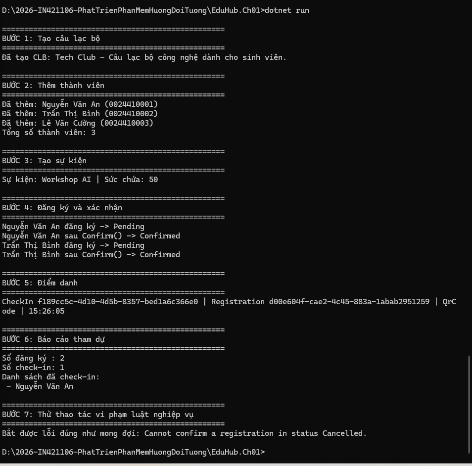

# EduHub - Bài tập CH01: Phân tích yêu cầu và Domain Modeling

Môn học IN4211 - Phát triển phần mềm hướng đối tượng (Đại học Đồng Tháp).
Sinh viên: Nguyễn Trọng Nghĩa - MSSV 0024418178.

## 1. Mô tả thiết kế domain

EduHub là hệ thống quản lý Câu lạc bộ và Sự kiện sinh viên. Domain gồm 5 class và 2 enum, đặt trong thư mục `Domain/`.

| Class | Vai trò | Quan hệ chính |
|---|---|---|
| `Member` | Thành viên sinh viên | Tham gia nhiều CLB, đăng ký nhiều sự kiện |
| `Club` | Câu lạc bộ | Có nhiều `Member`, tổ chức nhiều `Event` |
| `Event` | Sự kiện do CLB tổ chức | Thuộc 1 `Club` (qua `ClubId`), có nhiều `Registration` |
| `Registration` | Phiếu đăng ký (bảng nối Member - Event) | Chứa `MemberId`, `EventId`, trạng thái đăng ký |
| `CheckIn` | Ghi nhận điểm danh | Thuộc 1 `Registration` (qua `RegistrationId`) |

Hai enum thay cho chuỗi cố định:
- `RegistrationStatus`: `Pending`, `Confirmed`, `Cancelled`.
- `CheckInMethod`: `Manual`, `QrCode`.

Nguyên tắc thiết kế:
- Mọi property dùng `private set`, không có setter public.
- Constructor `private`, đối tượng được tạo qua factory method `static Create(...)` có kiểm tra dữ liệu đầu vào.
- Có behavior thật: `Registration.Confirm()` chỉ hợp lệ khi đang `Pending`, `Cancel()` không được huỷ lặp lại; vi phạm sẽ ném `InvalidOperationException`.
- Bật `<Nullable>enable</Nullable>` và có XML doc cho class và public member.

Tài liệu phân tích:
- [User stories](docs/user-stories.md)
- [Sơ đồ lớp](docs/class-diagram.md)

## 2. Cách chạy ứng dụng

Yêu cầu: cài .NET SDK 10.

```
cd EduHub.Ch01
dotnet build
dotnet run
```

## 3. Kết quả chạy

